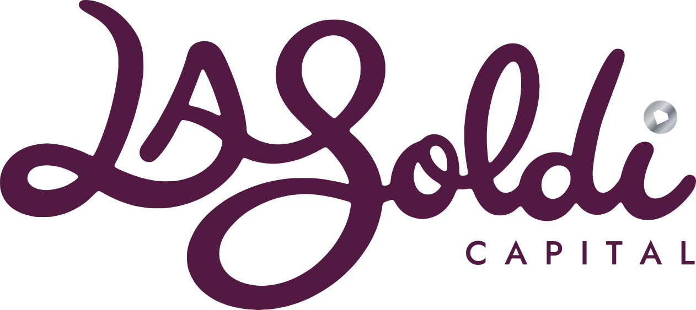
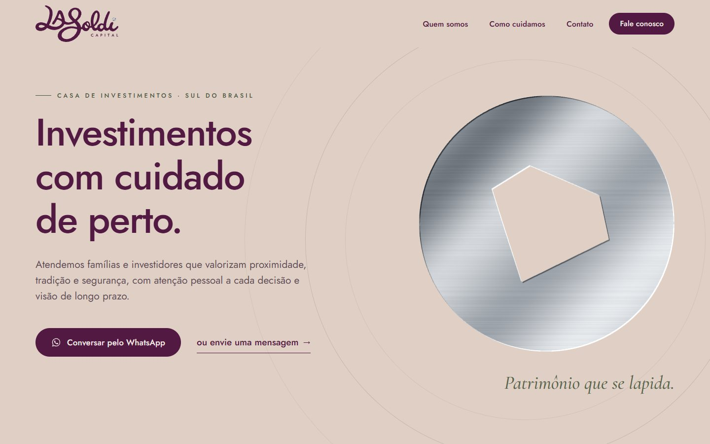
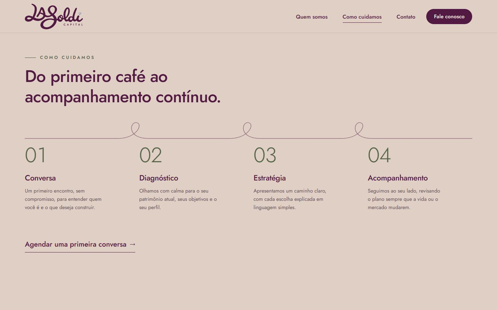
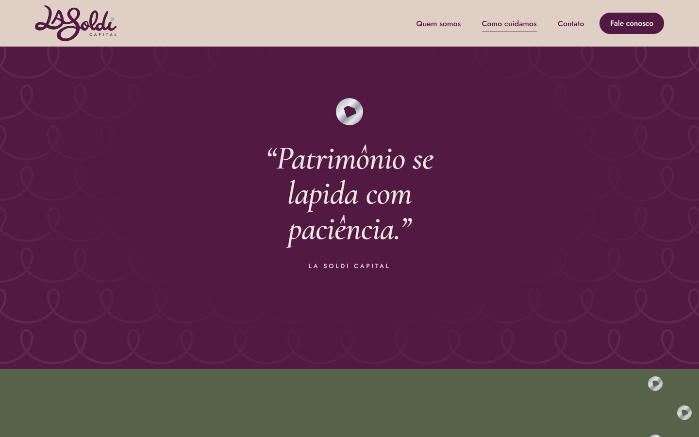
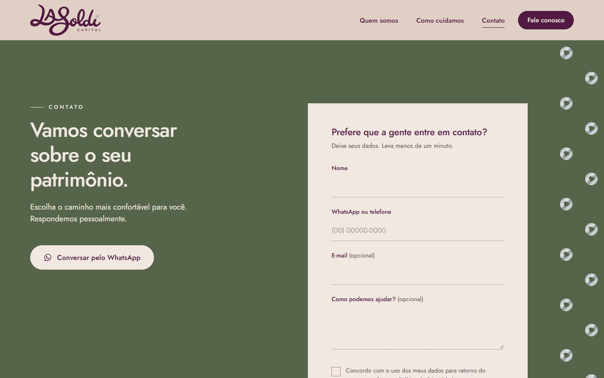
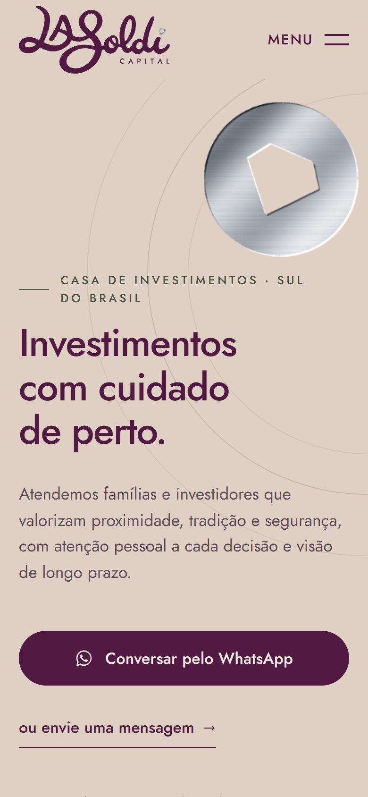
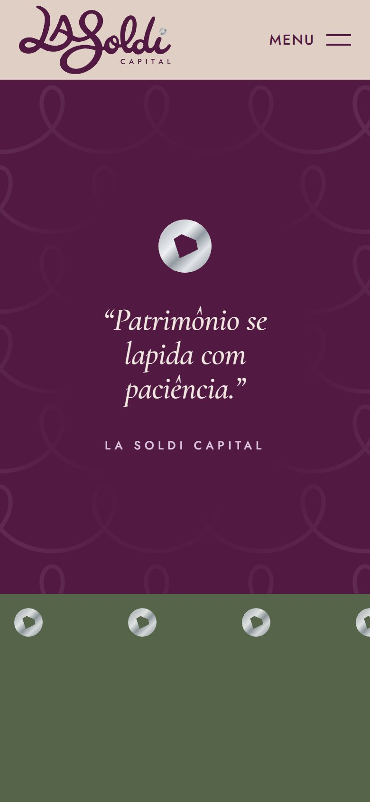
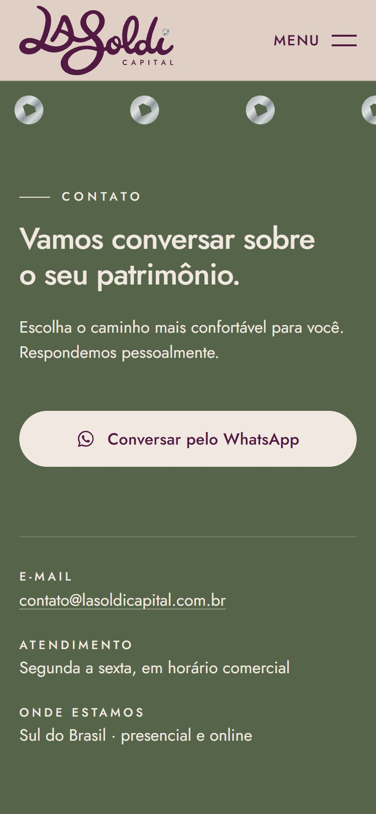

<div align="center">



# Patrimônio que se lapida

Site institucional da La Soldi Capital: objetivo como um cartão de visitas,<br>
com o acabamento de um estúdio digital premiado.


</div>



> **Versão de proposta.** Os textos foram escritos a partir do Brand Guide e são genéricos de propósito: o cliente
> valida e completa com os dados reais (serviços, pessoas, contatos e avisos regulatórios). O site não exibe nenhum
> número, certificação ou depoimento que não tenha sido confirmado.

---

## Sobre o projeto

A **La Soldi Capital** é uma casa de investimentos do Sul do Brasil, com uma marca construída sobre proximidade,
tradição e segurança. O conceito é *"Patrimônio que se lapida"*: uma assinatura escrita à mão e, no pingo do i,
uma moeda de prata com um diamante.

O briefing veio de um questionário rápido com o cliente, e as respostas viraram requisito de produto:

| Pergunta | Resposta do cliente |
|---|---|
| O que importa quando alguém entra no site? | Achar rápido as informações e entrar em contato |
| O site é como... | Um cartão de visitas bem feito: bonito, limpo e direto |
| Movimento na tela | Alguns efeitos suaves quando a pessoa rola a página |
| Cliente ideal | Prático, quer resolver logo |

Daí a regra que guiou todas as decisões: **simplicidade na experiência, sofisticação na execução.** Nada de
navegação experimental ou efeito que esconde o botão. O visitante entende em poucos segundos o que é a empresa,
para quem ela trabalha e como falar com ela, e o refinamento aparece na tipografia, na composição e em poucos
movimentos bem escolhidos.

## Direção visual

A identidade segue à risca o **Brand Guide v4** (direção de arte de Shiva Marques): logos, moeda e padrões são os
arquivos oficiais, sem redesenho.

| | Cor | Uso no site |
|---|---|---|
|  | **Areia** `#E0CFC4` | topo da página, cabeçalho, seções alternadas |
|  | **Linho** `#F1E8E2` | fundo base e painel do formulário |
|  | **Ameixa** `#521942` | títulos, botões e a seção de pausa editorial |
|  | **Musgo** `#566449` | contato e rodapé |
|  | **Prata** | sempre metálica (degradê oficial), nunca cinza chapado |

- **Tipografia:** Jost para títulos, textos e navegação; Cormorant Garamond Italic só em 3 momentos editoriais.
- **Proporção do manual respeitada:** areia e linho como base, ameixa na assinatura, prata só na moeda.
- **Contraste AA:** os tons de apoio foram escurecidos onde viram texto, sem sair da paleta.

## Destaques

**Lapidação, o movimento-assinatura.** As revelações se abrem a partir da **gema de 5 faces da moeda**, com as
coordenadas tiradas do próprio SVG oficial. A gema cresce e gira levemente até cobrir o elemento, como uma pedra
sendo aparada. Aparece só três vezes: na moeda do topo, na citação e no formulário.

**Prata viva.** A moeda do topo tem reflexo metálico de verdade: um shader WebGL de cerca de 4 KB, sem bibliotecas,
usa o SVG oficial como máscara e aplica o degradê oficial com escovado, relevo nas bordas da moeda e da gema e um
brilho lento que acompanha a rolagem e o mouse. O SVG estático é o que carrega primeiro; o shader entra depois,
roda a ~30 fps e para quando a moeda sai da tela.

**O traço contínuo.** Em *Como cuidamos*, as quatro etapas são ligadas por um único fio com laços, inspirado no
traço da assinatura, que se desenha conforme a rolagem.



**Uma pausa, um pico.** A única seção escura do site é a citação *"Patrimônio se lapida com paciência."*, em
ameixa com os laços do padrão oficial nas bordas. Ela se abre pela gema e as palavras entram uma a uma.



**Contato em um toque.** O WhatsApp é a ação principal e abre com a mensagem já escrita. No celular, um botão
flutuante fica ao alcance do polegar e some quando já existe outro botão de WhatsApp na tela. Para quem prefere,
um formulário curto: dois campos obrigatórios e o consentimento LGPD.



<p align="center">
  
  
  
</p>

## Feito com cuidado

| | |
|---|---|
| **Conversão** | WhatsApp na primeira dobra no desktop e no celular, botões com verbo e benefício, uma única ação principal, sem urgência falsa nem promessa de rentabilidade |
| **Acessibilidade** | Zero violações no axe (WCAG 2.1 AA) em desktop, tablet, celular e movimento reduzido. HTML semântico, foco visível, menu por teclado com Esc, erros do formulário anunciados |
| **Movimento responsável** | Com "reduzir movimento" nada se move e o WebGL nem carrega. Sem JavaScript, todo o conteúdo aparece; se a animação falhar, um temporizador de segurança libera tudo |
| **Mobile de verdade** | Pensado em 390×844 primeiro: moeda reposicionada, sem parallax, menu em tela cheia, shader com resolução reduzida |
| **Performance** | Sem framework e sem build. Fontes reduzidas para 57 KB em woff2, GSAP auto-hospedado, nenhuma foto ou vídeo, imagem principal pré-carregada |
| **Formulário seguro** | Validação no navegador e no servidor, honeypot, tempo mínimo de preenchimento, limite por IP, SMTP autenticado e credenciais fora do repositório |
| **SEO** | Títulos e descrições próprios, Open Graph com imagem 1200×630, dados estruturados (`FinancialService`), `robots.txt`, `sitemap.xml` e canonical |
| **Fidelidade à marca** | Só arquivos oficiais do kit. A prata aparece só na moeda, sempre sobre cor da paleta, nunca no lettering |
| **Testado** | Playwright + axe-core em 4 cenários (desktop, tablet, iPhone, movimento reduzido): console limpo, sem rolagem horizontal, nenhum conteúdo preso invisível. Relatório em [`docs/RELATORIO-CONVERSAO.md`](docs/RELATORIO-CONVERSAO.md) |

## Como funciona

Site estático em HTML, CSS e JavaScript puros, com um único endpoint em PHP para o formulário. O que está na
pasta é o que vai para o servidor.

```text
index.html ─── CSS (tokens → base → layout → componentes → motion)
     │
     ├── main.js ──► nav.js        cabeçalho, menu, seção ativa, WhatsApp flutuante
     │          ├──► reveal.js     GSAP + ScrollTrigger + SplitText
     │          │      └──► facet.js   movimento-assinatura (gema)
     │          ├──► coin-gl.js    shader WebGL da prata
     │          └──► form.js       validação e envio com fetch
     │
     └── formulário ──► api/contato.php ──► PHPMailer (SMTP da hospedagem)
```

## Rodar localmente

Requer PHP 8.1+.

```bash
php -S 127.0.0.1:8088
```

Abra **http://127.0.0.1:8088**. Sem o `api/config.php`, o formulário responde com uma mensagem amigável indicando
o WhatsApp; para testar o envio de verdade, crie o arquivo como descrito abaixo.

## Publicar

Hospedagem compartilhada com Apache e PHP (HostGator, Hostinger). Antes de subir:

1. **WhatsApp:** troque `5500000000000` pelo número real (55 + DDD + número) em `index.html` e `obrigado.html`.
2. **E-mail do formulário:** copie `api/config.example.php` para `api/config.php` e preencha com o SMTP da hospedagem.
3. **Dados de contato:** e-mail, horário e cidade no bloco de contato do `index.html`.
4. **Rodapé e páginas legais:** razão social, CNPJ e o texto regulatório (`index.html`, `avisos.html`). Em
   `privacidade.html`, preencha os trechos destacados em lilás.
5. **Domínio:** se não for `lasoldicapital.com.br`, ajuste `canonical`, `og:*`, JSON-LD, `sitemap.xml`,
   `robots.txt` e `.htaccess`.

Envie o conteúdo da pasta para o `public_html/`, **sem** `_kit/`, `docs/`, `.github/` e arquivos `.md`
(o `.htaccess` também bloqueia esses caminhos). Confira se o `.htaccess` oculto subiu: ele força HTTPS, configura
cache e cabeçalhos de segurança.

## Onde editar os textos

Tudo está em HTML, no `index.html`, separado por comentários: `M1 · HERO`, `M2 · QUEM SOMOS`,
`M3 · COMO CUIDAMOS`, `M4 · PAUSA EDITORIAL`, `M5 · CONTATO` e `M6 · RODAPÉ`. As animações se ajustam sozinhas a
textos maiores ou menores. Cores, fontes, espaçamentos e tempos de animação ficam em
[`assets/css/tokens.css`](assets/css/tokens.css).

## Estrutura

```text
├── index.html               página única (6 seções)
├── privacidade.html         política de privacidade (base LGPD)
├── avisos.html              avisos legais e regulatórios
├── obrigado.html            retorno do formulário sem JavaScript
├── .htaccess                HTTPS, cache, cabeçalhos e bloqueios
├── robots.txt · sitemap.xml · site.webmanifest
├── api/
│   ├── contato.php          endpoint do formulário
│   ├── config.example.php   modelo das credenciais SMTP (config.php fica fora do git)
│   └── lib/PHPMailer/
├── assets/
│   ├── css/                 tokens, base, layout, componentes, motion
│   ├── js/                  main, nav, reveal, facet, coin-gl, form
│   ├── vendor/              GSAP, ScrollTrigger e SplitText
│   ├── fonts/               Jost e Cormorant Garamond Italic (woff2)
│   ├── brand/               logos, moeda e padrões oficiais
│   ├── icons/               favicon, apple-touch-icon e ícones do manifest
│   └── img/                 imagem de compartilhamento (Open Graph)
└── docs/
    ├── BRIEF.md             briefing, decisões e pendências do cliente
    ├── ESTRUTURA.md         arquitetura da página e textos propostos
    ├── DESIGN.md            direção criativa, tokens e storyboard
    └── RELATORIO-CONVERSAO.md   revisão de conversão e QA
```

## Como foi construído

| Etapa | O que entregou | |
|---|---|---|
| **1. Análise** | Leitura do Brand Guide e do kit, questionário do cliente, mapa do que falta | ✅ |
| **2. Direção criativa** | Conceito "Lapidação", paleta aplicada, tipografia, storyboard em 6 momentos | ✅ |
| **3. Mensagem** | Arquitetura one-page e textos propostos, sem inventar dados | ✅ |
| **4. Construção** | HTML semântico, design system em tokens, responsividade | ✅ |
| **5. Motion** | GSAP, gema facetada, fio contínuo e shader da prata | ✅ |
| **6. Formulário** | PHPMailer com validação, anti-spam e LGPD | ✅ |
| **7. QA** | Playwright + axe em 4 cenários, correções e revisão de conversão | ✅ |
| **8. Dados do cliente** | Serviços, pessoas, contatos e textos regulatórios | ⏳ |
| **9. Publicação** | Domínio, SMTP, envio real e Core Web Vitals em produção | ⏳ |

## Créditos

- Projeto, direção criativa e desenvolvimento: [Alexandre Garcia](https://alexandregarcia.dev/)
- Identidade visual La Soldi Capital: Shiva Marques (direção de arte)
- Animações: [GSAP](https://gsap.com) (licença padrão GreenSock, gratuita)
- Formulário: [PHPMailer](https://github.com/PHPMailer/PHPMailer) (LGPL 2.1)
- Fontes: [Jost](https://fonts.google.com/specimen/Jost) e [Cormorant Garamond](https://fonts.google.com/specimen/Cormorant+Garamond) (SIL Open Font License)

## Licença

O código é de uso do projeto. A marca La Soldi Capital, o lettering, a moeda-diamante, os padrões e os textos
institucionais pertencem à La Soldi Capital, com todos os direitos reservados. Bibliotecas de terceiros mantêm as
suas próprias licenças.

---

<div align="center">

**Feito por Alexandre Garcia** · [alexandregarcia.dev](https://alexandregarcia.dev/)

[LinkedIn](https://www.linkedin.com/in/alexandregarcia-junior/) · [GitHub](https://github.com/AlexandreGarciaJr) · [E-mail](mailto:alexandregojunior@gmail.com)

</div>
