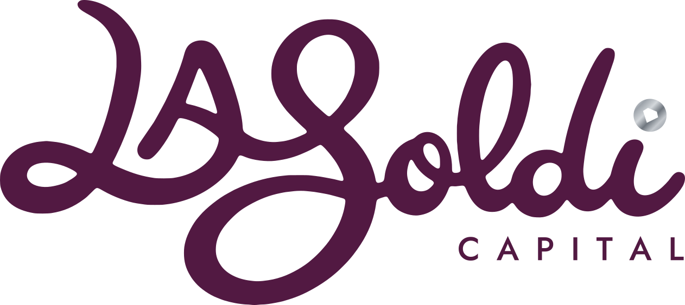
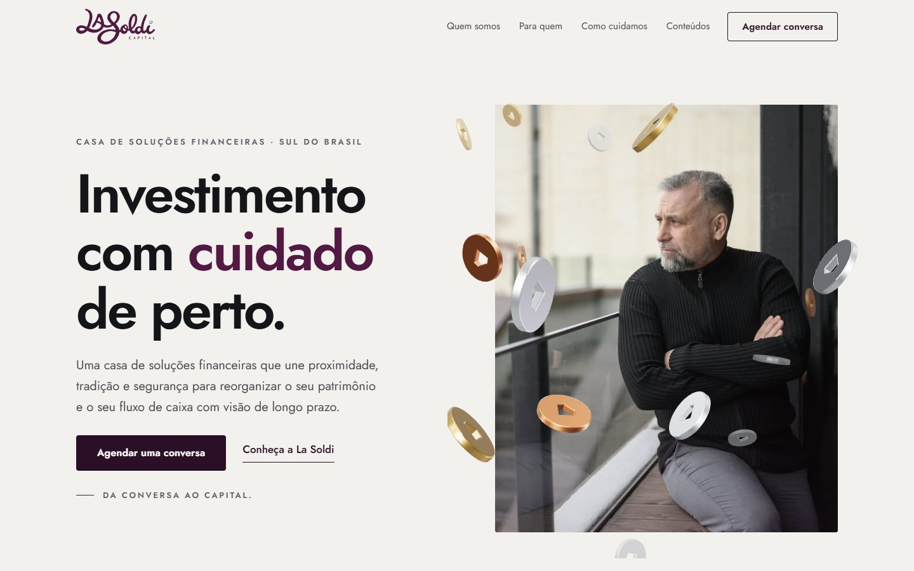
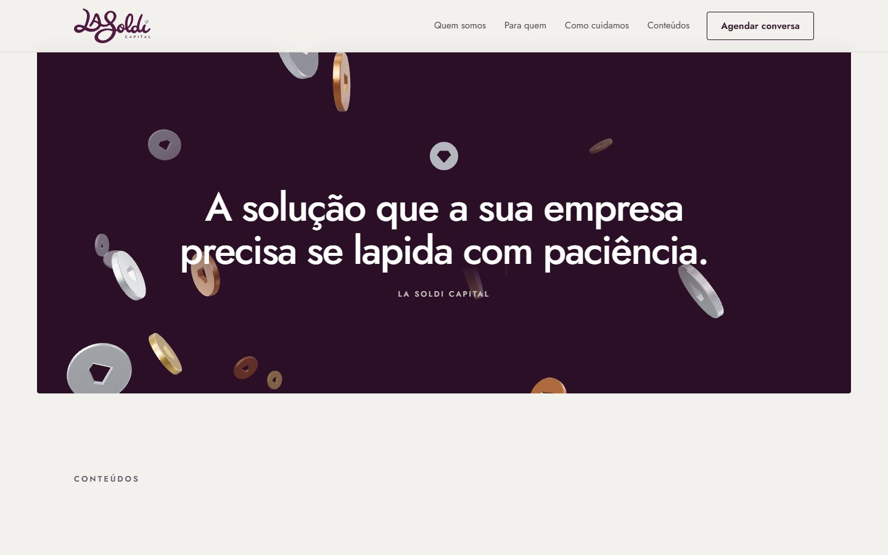
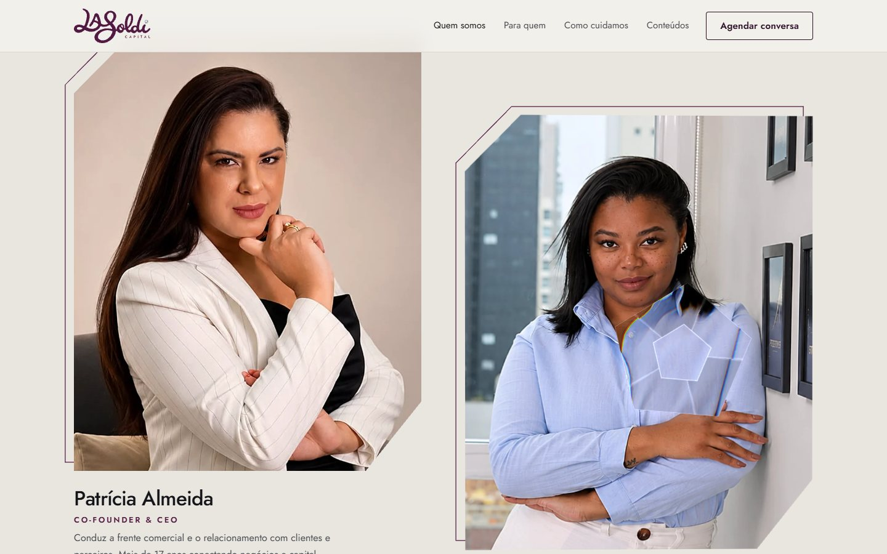
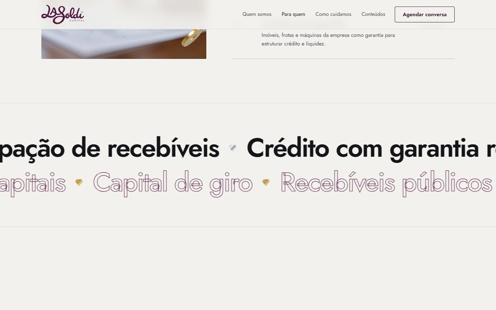
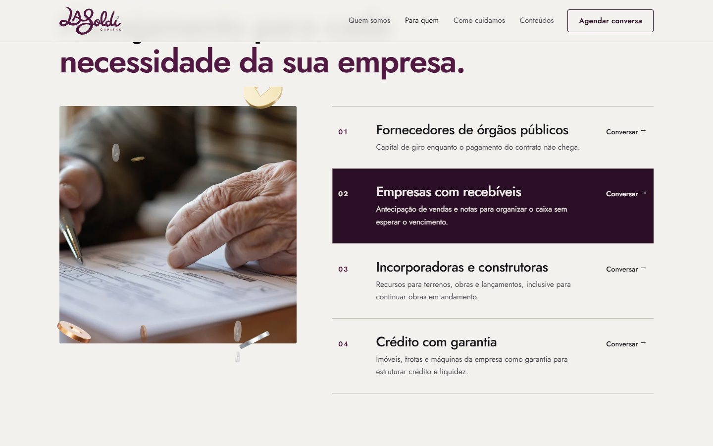
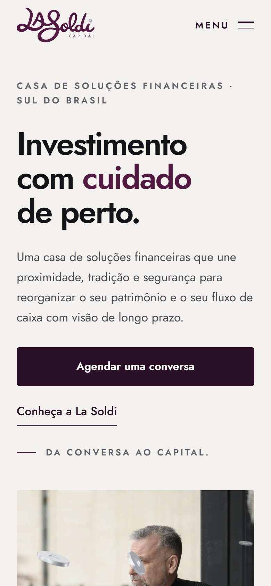
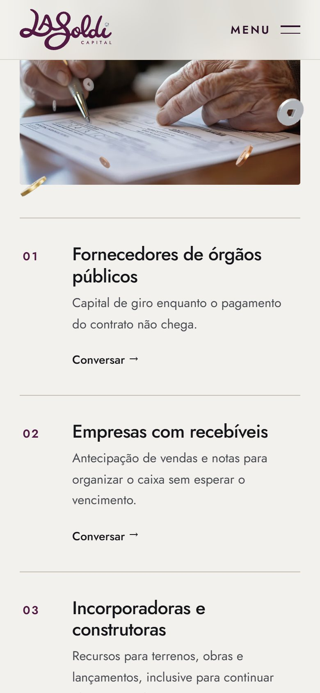
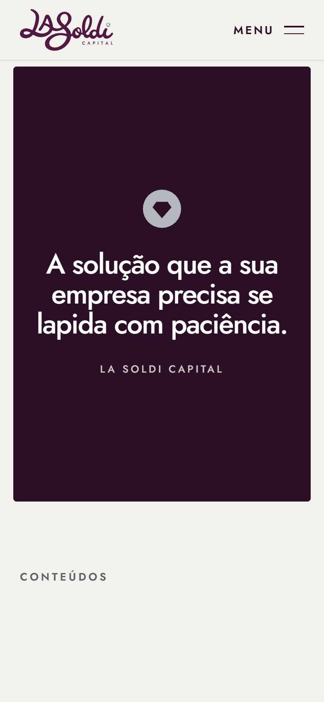

<div align="center">



# Da conversa ao capital

Site da La Soldi Capital, a casa de soluções financeiras do Grupo Diamond:<br>
claro e direto como o cliente pediu, com moedas 3D de verdade caindo pela página.


**[Ver o preview →](https://alexandregarciajr.github.io/lasoldi-website/)** <sub>(GitHub Pages)</sub>

</div>



> **Versão 2 (repaginada).** O visual segue o protótipo aprovado pelo cliente (V02, da agência Chama), com os textos
> corrigidos pela proprietária e as informações do dossiê do Grupo Diamond. Fotos das sócias, CNPJ e conteúdos ainda
> dependem do cliente ([`docs/BRIEF-V2.md`](docs/BRIEF-V2.md)). No preview (GitHub Pages, sem PHP), o formulário não envia.

---

## Sobre o projeto

O **Grupo Diamond** reúne três empresas: a **DI Private** (banco digital), a **La Soldi Capital** (relacionamento e
condução comercial) e a **La Diamond Securitizadora** (crédito e securitização). A La Soldi é a porta de entrada: recebe
a empresa, entende a necessidade e conduz a solução financeira, seja capital de giro, antecipação de recebíveis, crédito
com garantia ou estruturação de capital.

O cliente pediu um site **objetivo**: informação rápida e contato fácil. A primeira versão tinha uma estética própria; o
cliente aprovou um novo visual (claro, editorial, com fotos) e pediu que os efeitos ficassem **ainda mais caprichados**.
Esta versão junta as duas coisas: o layout do protótipo aprovado com a camada de movimento e 3D construída aqui.

## Destaques

**Moedas 3D de verdade, nas cores do grupo.** No lugar da moeda gigante, uma chuva de moedas renderizadas em tempo real
com Three.js. Cada moeda é o símbolo do grupo (disco com a gema vazada) gerado em código, com material metálico
escovado, reflexo de ambiente, tone mapping ACES e uma contraluz lilás que separa a borda do fundo. Três metais, uma
empresa cada: **prata** (La Soldi), **ouro** (DI Private) e **bronze** (La Diamond). Duas camadas de profundidade
dão volume, as moedas desviam do cursor, a câmera acompanha o mouse e a velocidade da rolagem acelera a queda. A cena
aparece no topo, sobre a foto do "Para quem" e no painel da citação, onde as moedas se dissolvem perto da frase.



**Lapidação, o movimento-assinatura.** Fotos, sócias, painel da citação e formulário se abrem a partir da gema de 5
faces da moeda, que cresce e gira até cobrir o elemento. As fotos das sócias usam a moldura com cantos cortados do
protótipo, que segue as mesmas faces.

**Lente lapidada nas sócias.** As fotos das fundadoras são desenhadas em WebGL e, no desktop, o cursor vira uma
pequena gema de 5 faces que refrata a imagem como um diamante: a mesa central amplia, cada faceta desvia a foto na
direção da sua face, com leve dispersão de cor e brilho prata nas arestas. Fora da lente, a foto fica intacta. O
cartão inclina em 3D na direção do mouse enquanto o contorno ameixa se desloca ao contrário, a foto entra com uma onda
que assenta, ondula de leve com a velocidade da rolagem e o nome entra letra a letra. No celular ficam a onda e a
ondulação; com "reduzir movimento" ou sem WebGL, a foto normal.



**Faixa de soluções.** Entre "Para quem" e "Como cuidamos", duas linhas gigantes correm em sentidos opostos com as
frentes reais do grupo (antecipação de recebíveis, crédito com garantia real, imobiliário e construção, frotas,
leaseback, estruturação de capital), separadas pela gema em prata e ouro. A rolagem acelera, inverte e inclina a faixa.



**Tudo leva ao formulário.** Cada segmento de "Para quem" (fornecedores de órgãos públicos, empresas com recebíveis,
incorporadoras e construtoras, crédito com garantia) abre o formulário já com o assunto escrito. No hover, a linha se
enche de ameixa a partir do lado em que o cursor entrou.



**E os detalhes de sempre:** topo que entra e sai com a rolagem, títulos subindo linha a linha por trás de máscara,
números que contam até o valor real, manifesto que ganha tinta conforme a leitura, fio que atravessa as etapas, botões
com preenchimento que nasce do cursor, texto que rola e efeito magnético, e rolagem suave com Lenis.

<p align="center">
  
  
  
</p>

## Feito com cuidado

| | |
|---|---|
| **3D responsável** | Moedas e lente dividem um único arquivo do Three.js, que carrega só depois do conteúdo; as cenas pausa fora da tela e com a aba oculta, limita a resolução (1,75× no desktop, 1,6× no celular) e usa malhas instanciadas: 6 chamadas de desenho por área |
| **Plano B** | Sem WebGL, entram moedas renderizadas (imagens) paradas no lugar. Com "reduzir movimento", a cena mostra um quadro parado e nada se move |
| **Mobile de verdade** | Menos moedas, sem desvio do cursor, menu em tela cheia, botões largos e nenhum efeito que dependa de hover |
| **Acessibilidade** | Zero violações no axe (WCAG 2.1 AA) em desktop, tablet, celular e movimento reduzido. A faixa animada tem versão em lista para leitores de tela |
| **Formulário seguro** | Validação no navegador e no servidor, honeypot, tempo mínimo, limite por IP e SMTP autenticado (PHPMailer) |
| **Testado** | Playwright + axe-core em 4 cenários: console limpo, sem rolagem lateral, nenhum conteúdo preso invisível e o topo se recompondo ao voltar |

## Como funciona

```text
index.html ── CSS (tokens → base → site → motion)
   │
   └── main.js ─► nav.js · form.js · hover.js · smooth.js (Lenis)
                ├► reveal.js ─► hero.js · ticker.js · facet.js (gema)
                ├► coins.js ─► 3d/coins.js ─┐
                └► lens.js  ─► 3d/lens.js  ─┴► 3d/three-[hash].js  (Three.js compartilhado, sob demanda)
                                    ▲
                src/coins + src/lens  ── npm run build:3d (esbuild, com divisão de código)

formulário ─► api/contato.php ─► PHPMailer (SMTP da hospedagem)
```

Só as cenas 3D (moedas e lente) têm build: o resto do site é HTML, CSS e JavaScript puros, servidos como estão.

## Rodar localmente

```bash
npm install
```
```bash
npm run build:3d
```
```bash
php -S 127.0.0.1:8088
```

A pasta `assets/js/3d/` já vem gerada; o `npm run build:3d` só é necessário depois de mexer em `src/`.

## Publicar

1. **E-mail do formulário:** copie `api/config.example.php` para `api/config.php` e preencha com o SMTP da hospedagem.
2. **Rodapé e avisos legais:** razão social, CNPJ e endereço.
3. **Domínio:** se não for `lasoldicapital.com.br`, ajuste `canonical`, `og:*`, JSON-LD, `sitemap.xml`, `robots.txt` e `.htaccess`.

Envie para o `public_html/` **sem** `_kit/`, `docs/`, `src/`, `node_modules/`, `.github/`, `package*.json` e arquivos `.md`.

## Estrutura

```text
├── index.html · privacidade.html · avisos.html · obrigado.html
├── src/coins · src/lens      cenas 3D das moedas e da lente (fonte)
├── api/                      contato.php, config.example.php, PHPMailer
├── assets/
│   ├── css/                  tokens, base, site, motion
│   ├── js/                   main, nav, form, hover, smooth, reveal, hero, ticker, facet, coins, lens
│   ├── js/3d/                cenas 3D geradas (coins, lens e o Three.js compartilhado)
│   ├── vendor/               GSAP, ScrollTrigger, SplitText, Lenis
│   ├── img/fotos/            fotos do protótipo aprovado (V02)
│   ├── img/moedas/           moedas renderizadas (plano B sem WebGL)
│   ├── brand/                logos, moeda com gema, logos do Grupo Diamond
│   ├── fonts/ · icons/
└── docs/                     BRIEF-V2 (atual) · BRIEF, ESTRUTURA, DESIGN (histórico da V1)
```

## Como foi construído

| Etapa | O que entregou | |
|---|---|---|
| **V1** | Direção "Lapidação" sobre o Brand Guide, motion, formulário, QA | ✅ |
| **Revisão do cliente** | Sem WhatsApp: todo contato pelo formulário | ✅ |
| **V2 · leitura** | Protótipo aprovado (PDF + HTML), dossiê do Grupo Diamond e correções da proprietária | ✅ |
| **V2 · 3D** | Moedas em Three.js nos três metais do grupo, com plano B e versão mobile | ✅ |
| **V2 · site** | Layout do protótipo, textos novos, faixa de soluções, efeitos e QA | ✅ |
| **V2 · sócias** | Lente lapidada em WebGL, inclinação 3D e nome letra a letra | ✅ |
| **Dados do cliente** | Fotos confirmadas das sócias, foto do "Para quem", CNPJ e conteúdos | ⏳ |
| **Publicação** | Domínio, SMTP e Core Web Vitals em produção | ⏳ |

## Créditos

- Projeto, direção de movimento, 3D e desenvolvimento: [Alexandre Garcia](https://alexandregarcia.dev/)
- Direção visual do protótipo V02 e identidade La Soldi: agência Chama · Shiva Marques
- [Three.js](https://threejs.org) (MIT) · [GSAP](https://gsap.com) · [Lenis](https://github.com/darkroomengineering/lenis) (MIT) · [PHPMailer](https://github.com/PHPMailer/PHPMailer) (LGPL 2.1) · [Jost](https://fonts.google.com/specimen/Jost) (OFL)

## Licença

A marca La Soldi Capital, a marca Grupo Diamond, os logotipos, as fotos e os textos institucionais pertencem aos seus
titulares, com todos os direitos reservados. Bibliotecas de terceiros mantêm as suas próprias licenças.

---

<div align="center">

**Feito por Alexandre Garcia** · [alexandregarcia.dev](https://alexandregarcia.dev/)

[LinkedIn](https://www.linkedin.com/in/alexandregarcia-junior/) · [GitHub](https://github.com/AlexandreGarciaJr) · [E-mail](mailto:alexandregojunior@gmail.com)

</div>
